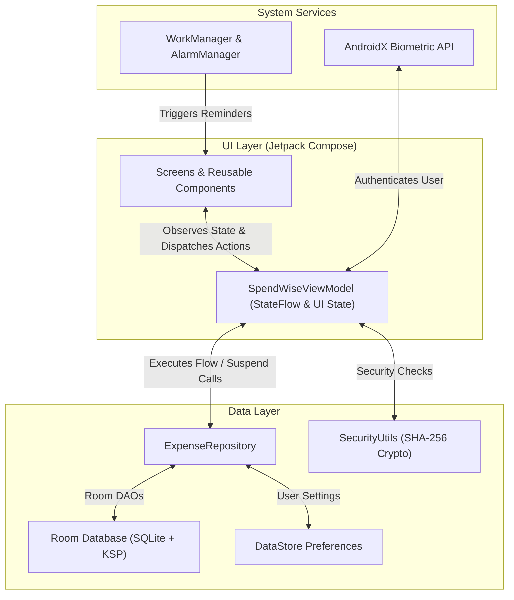
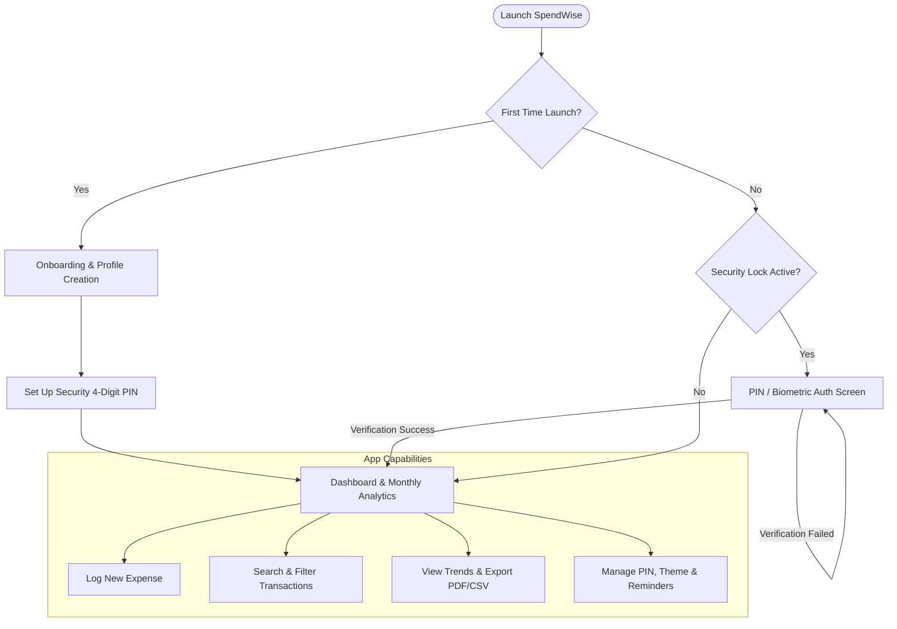

<div align="center">

  

  # SpendWise

  ### *Smart, Private & Offline-First Personal Finance Manager for Android*

  [](https://github.com/vishwajeetchandole/SpendWise/actions)
  [-3DDC84?style=for-the-badge&logo=android&logoColor=white)](https://developer.android.com)
  [](https://kotlinlang.org)
  [](https://developer.android.com/jetpack/compose)
  [](https://developer.android.com/topic/architecture)
  [](LICENSE)

  <p align="center">
    <b>SpendWise</b> is an intuitive, modern, and completely private personal finance application engineered for Android.<br/>
    Built using <b>Jetpack Compose</b>, <b>Material 3</b>, and <b>Room Database</b>, SpendWise puts you in full control of your money without tracking, cloud dependencies, or advertisements.
  </p>

</div>

---

## 📖 Table of Contents
- [✨ Key Features](#-key-features)
- [🏗️ System Architecture](#️-system-architecture)
- [🔄 User Flow & App Lifecycle](#-user-flow--app-lifecycle)
- [🛠️ Tech Stack & Libraries](#️-tech-stack--libraries)
- [📁 Project Structure](#-project-structure)
- [🚀 Getting Started](#-getting-started)
- [🔒 Privacy & Security](#-privacy--security)
- [🤝 Contributing](#-contributing)
- [📄 License](#-license)

---

## ✨ Key Features

| Feature | Description |
| :--- | :--- |
| **📊 Smart Analytics & Charts** | Interactive category distribution donut charts, daily expenditure bar graphs, and monthly trend comparisons. |
| **💸 Effortless Expense Logging** | Fast transaction entry with auto-category suggestions, customized dates, tags, and payment methods. |
| **🔒 Biometric & PIN Security** | Local account guard with SHA-256 PIN encryption and native Android Biometric (Fingerprint/Face) lock. |
| **📄 Export & Backup** | Export print-ready formatted PDF expense sheets, CSV raw financial logs, or complete JSON database backups. |
| **🏷️ Category Manager** | Create, customize, or delete expense categories with custom icons and color swatches. |
| **🔔 Daily Log Reminders** | Native background notifications powered by `AlarmManager` and `WorkManager` to build consistent logging habits. |
| **🎨 Material 3 & Localization** | Dynamic dark/light themes, custom currency symbol selection, and Indian Lakhs/Crores number formatting (`₹1,24,000`). |
| **🛡️ 100% Offline & Private** | Zero telemetry, zero analytics trackers, and zero cloud sync. All data is saved strictly on your local device. |

---

## 🏗️ System Architecture

SpendWise follows **Clean Architecture** principles and the **MVVM (Model-View-ViewModel)** design pattern with **Unidirectional Data Flow (UDF)**.



---

## 🔄 User Flow & App Lifecycle



---

## 🛠️ Tech Stack & Libraries

- **Language**: [Kotlin](https://kotlinlang.org/) `2.0.21`
- **UI Framework**: [Jetpack Compose](https://developer.android.com/jetpack/compose) with Material Design 3
- **Architecture**: MVVM, Unidirectional Data Flow, Kotlin Coroutines, `StateFlow`
- **Persistence**: [Room Database](https://developer.android.com/training/data-storage/room) `2.6.1` (KSP), [DataStore Preferences](https://developer.android.com/topic/libraries/architecture/datastore) `1.1.1`
- **Security**: AndroidX Biometric `1.2.0-alpha05`, SHA-256 Password Hashing
- **Image Loading**: [Coil Compose](https://coil-kt.github.io/coil/compose/) `2.7.0`
- **Background Processing**: [WorkManager](https://developer.android.com/topic/libraries/architecture/workmanager) & `AlarmManager`
- **Build Tooling**: Gradle Kotlin DSL, Version Catalogs (`libs.versions.toml`), KSP
- **Testing**: JUnit 4, Robolectric `4.14.1`, AndroidX Compose UI Test

---

## 📁 Project Structure

```
spendwise/
├── .github/
│   └── workflows/
│       └── android-ci.yml          # Automated CI pipeline (Build & Unit Tests)
├── app/
│   ├── src/
│   │   ├── main/
│   │   │   ├── java/com/spendwise/
│   │   │   │   ├── data/           # Local Room DB, DAOs, Entities, Models, Preferences
│   │   │   │   ├── ui/             # Composable Screens, Dialogs, Charts, Navigation, Theme
│   │   │   │   ├── util/           # PDF/CSV Export, Alarm Receivers, Security, Formatters
│   │   │   │   └── MainActivity.kt
│   │   │   ├── res/                # Drawables, Mipmap Icons, Values, Themes
│   │   │   └── AndroidManifest.xml
│   │   ├── test/                   # Unit & Robolectric Tests
│   │   └── androidTest/            # Android Instrumented UI Tests
│   ├── build.gradle.kts
│   └── proguard-rules.pro
├── art/                            # Official icons, logos, and repository graphics
├── gradle/
│   └── libs.versions.toml          # Centralized Version Catalog
├── .gitignore                      # Optimized Git ignore configuration
├── build.gradle.kts
├── README.md                       # Repository Documentation
└── LICENSE                         # MIT License
```

---

## 🚀 Getting Started

### Prerequisites
- **Android Studio**: Ladybug (2024.2.1) or newer
- **JDK**: Version 17 (bundled with Android Studio)
- **Target Device**: Android Phone or Emulator running **API Level 24 (Android 7.0)** or higher

### Build & Run from Source

1. **Clone the Repository**:
   ```bash
   git clone https://github.com/vishwajeetchandole/SpendWise.git
   cd SpendWise
   ```

2. **Open in Android Studio**:
   - Open Android Studio -> Select **Open** -> Choose the `spendwise` root folder.
   - Wait for Gradle to download dependencies and finish indexing.

3. **Run the App**:
   - Select the `:app` run configuration.
   - Select a physical device or emulator.
   - Click **Run** (`Shift + F10`).

4. **Execute Unit Tests**:
   ```bash
   # Run all unit tests and Robolectric test suite
   ./gradlew testDebugUnitTest

   # Build output debug APK
   ./gradlew assembleDebug
   ```

---

## 🔒 Privacy & Security

- **Local Execution**: All transaction logs, profile pictures, PIN hashes, and customized settings are saved strictly inside the app's sandboxed local SQLite database / DataStore.
- **Zero Cloud Leakage**: SpendWise makes **no network calls**. There are no analytical endpoints, no remote databases, and no third-party trackers.
- **Biometric Protection**: Biometric data is evaluated natively by Android's hardware keystore via `androidx.biometric` and is never accessed or stored directly by the app code.

---

## 🤝 Contributing

Contributions, feature suggestions, and bug reports are welcome!

1. **Fork** the repository.
2. Create a new feature branch (`git checkout -b feature/AmazingFeature`).
3. Commit your changes (`git commit -m 'Add AmazingFeature'`).
4. Push to the branch (`git push origin feature/AmazingFeature`).
5. Open a **Pull Request**.

---

## 📄 License

Distributed under the **MIT License**. See [`LICENSE`](LICENSE) for complete details.

---

<div align="center">

  Designed & Developed with ❤️ by **[Vishwajeet Chandole](https://github.com/vishwajeetchandole)**

</div>
